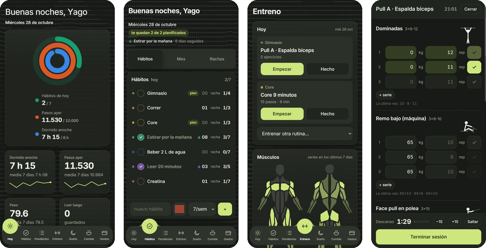
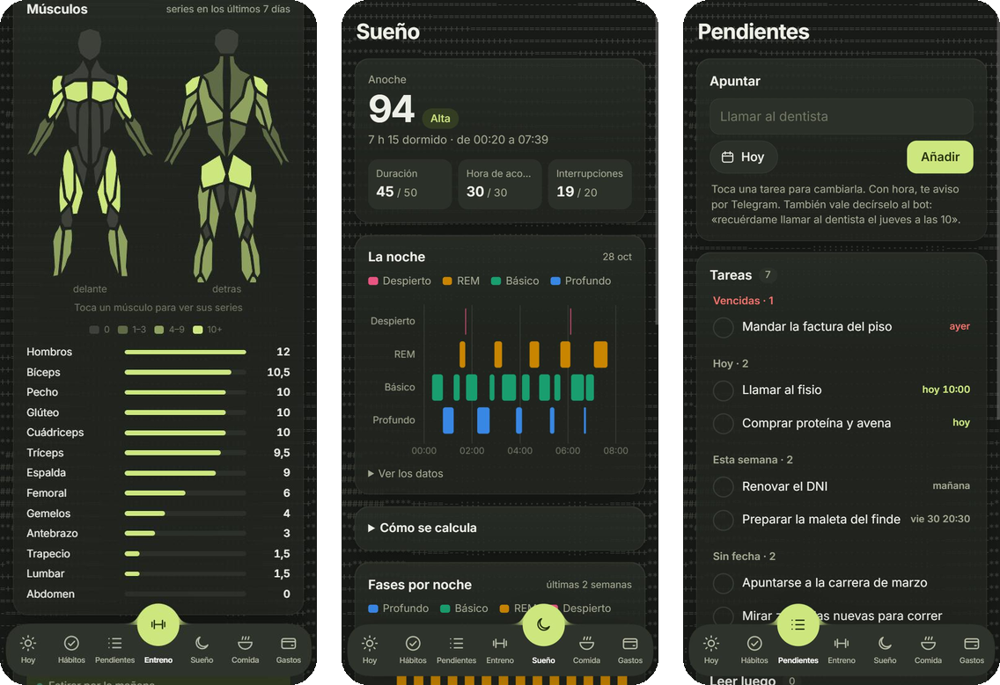
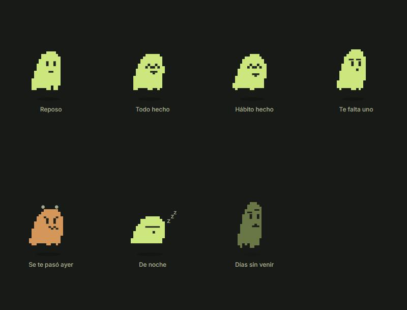

# todo

> Hoy toca pierna, leer y dormir 8 horas: hábitos, entreno, salud y pendientes en una sola app.

Mi app personal del día a día: hábitos, entrenamiento, sueño, peso y pendientes en una sola web
instalable en el iPhone, con un fantasma que reacciona a lo que haces. Corre en una Raspberry Pi, sin base de datos y sin framework de frontend.




<sub>Capturas con datos inventados.</sub>

## Qué hace

- **El fantasma** — sale en todas las páginas y cambia de cara y de forma según lo que pase: salta al
  marcar un hábito, se enfada y te enseña lo que se quedó sin hacer ayer, se duerme de noche y se
  desvanece si pasas días sin venir. Hace gestos por su cuenta y a veces se da un paseo por la página.
  Cada usuario elige la suya: el fantasma de píxeles o una flor garabateada a boli (`static/mascota.js`).

  

- **Hoy** — la portada: tres anillos (hábitos, pasos y sueño), cifras con su tendencia de 7 días,
  las tareas que vencen, el año en puntos y tarjetas de las otras apps (comida y gastos).
- **Hábitos** — marcar el día, rachas con llama, objetivo semanal por hábito, calendario tipo
  mapa de calor de GitHub y planificación arrastrando hábitos a los días.
- **Entreno**
  - *Modo entreno* serie a serie: los kilos de la última vez ya puestos, descanso con cuenta atrás y pitido,
    y la pantalla encendida mientras entrenas (Wake Lock).
  - *Doble progresión*: si la última vez todas las series llegaron al tope del rango, sugiere subir peso.
  - *Músculos de la semana* en un mapa delante/detrás y en barras, a partir de los ejercicios hechos.
  - *Progreso* por ejercicio (1RM estimado con Epley, récords) e historial.
  - *Rutinas guiadas* con temporizador (movilidad de la mañana, core) que se reanudan si la app se recarga.
  - Un monigote animado por ejercicio (SVG dibujado a mano, `static/monigotes.js`).
- **Carrera** — plan de 5k que se recalcula cada noche con lo que corres de verdad (`carrera.py`).
- **Salud** — fases de la noche, nota de 0 a 100, pasos, peso con su media de 7 días y composición
  de la báscula, con los datos de Salud del iPhone.
- **Pendientes** — tareas guardadas como Markdown en un vault de Obsidian (formato del plugin Tasks).
- **Ajustes** — nombre, qué secciones están activas, cuáles salen en la barra de abajo y la mascota.
- **Avisos** por Web Push y un **widget** para Scriptable (`static/widget-hoy.js`).

## Cómo está hecho

- **Backend:** FastAPI (`main.py`). Todo el estado es un `data.json`.
  - El cliente lo trae entero y lo devuelve entero (`PUT /api/state`).
  - `clean()` lo reconstruye con una forma fija antes de guardar.
  - Cada guardado lleva la versión (`X-Version`): si otra pestaña escribió entre medias, da 409 en vez de pisarlo.
  - Se escribe de forma atómica (temporal + `fsync` + `rename`).
  - Los ajustes van aparte, en un `ajustes.json` junto a los datos, para que ese guardado no pueda pisarlos.
  - Otro usuario es otra instancia: el mismo código con otro `.env`, otro puerto y sus propios datos.
- **Frontend:** HTML, CSS y JavaScript sin compilar, una página por sección.
  - El estilo común («Calma»: tokens, menú inferior, fondo ASCII, hojas) va en `static/calma.css` y `static/calma.js`.
  - Gráficas con Chart.js y animaciones con anime.js; sin ellos, la página funciona igual.
- **Entrada de datos desde el móvil:** atajos de iOS y un bot de Telegram llaman a endpoints de una sola llamada
  (`POST /api/entreno`, `POST /api/salud`, `POST /api/tarea`).
- **Acceso:** contraseña con cookie firmada por HMAC; las máquinas entran con `Authorization: Bearer`.
  En producción va además detrás de Cloudflare Access.

## Ponerlo en marcha

```bash
uv sync
TODO_PASS=una-clave TODO_SECRET=$(openssl rand -hex 16) uv run uvicorn main:app --port 8082
```

| Variable | Para qué |
| --- | --- |
| `TODO_PASS`, `TODO_SECRET` | Contraseña y secreto de la cookie. Sin ellas la app responde 503: falla cerrada. |
| `TODO_DB` | Ruta del `data.json` (por defecto, junto a `main.py`). |
| `TODO_SUBS` | Suscripciones de Web Push, en su propio fichero. |
| `VAULT` | Carpeta del vault de Obsidian para Pendientes. |
| `VAPID_PUB` | Clave pública VAPID de los avisos. |
| `GASTOS_URL` | Dónde está la app de gastos de esta instancia. |

Pruebas: `uv run python test_todo.py`.
